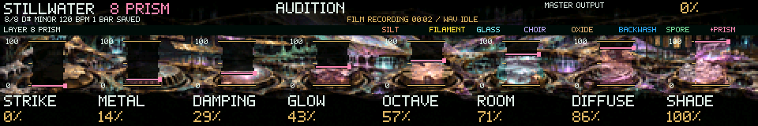
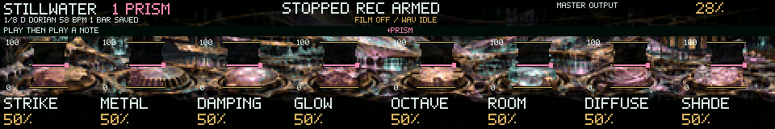
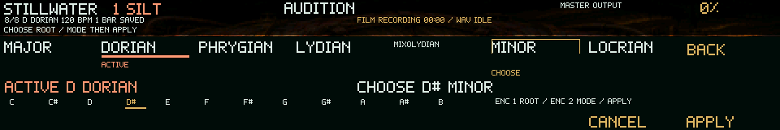

<div align="center">

# Stillwater

**A small ambient instrument. Eight sound worlds. One growing loop.**

An independent, open-source instrument for **Ableton Push 3 Standalone**.
Custom sound, custom screen, running on the device.



*Actual V4 display pixels from a scripted, isolated device test. Not a camera photograph.*

[Get started](#play-a-little) · [Install](docs/INSTALL.md) · [Controls](docs/CONTROLS.md) · [Develop](docs/DEVELOPMENT.md) · [Agent guide](AGENTS.md)

</div>

Stillwater turns the pad grid into a looping ambient instrument. Press Play and
play a note to anchor a one-bar phrase. Add another layer, shape its material,
and let the loop grow. Every pad stays a scale note, including while browsing
songs or recordings. The screen’s little vessels fill with each macro value;
their texture moves with the real sound. Notes from every layer light the pads
in that sound’s color.

Python handles the screen, controls and local files. An original C engine makes
the sound and schedules notes. No computer, cloud account, subscription, onboard
language model or network listener is needed during play.

## Eight worlds to play

**Silt · Filament · Glass · Choir · Oxide · Backwash · Spore · Prism**

Eight distinct sources and effect buses, with eight live macros per sound:
subtractive warmth, plucked filaments, glassy FM, formants, tape, reverse,
grains and modal shimmer. Build up to eight layers, mix them independently,
and shape held notes with pressure.



*Silent GIF: synthetic production-renderer preview, fixed macros, native playback
then Stop. No physical performance is implied. [Media provenance](docs/MEDIA.md).*

## Play a little

| Control | What happens |
|---|---|
| **Play + a pad** | Start a fresh one-bar loop from your first note |
| **Record** | Toggle note overdub / audition without restarting playback |
| **New** | Choose another available sound; **Shift+New** archives and starts fresh |
| **Repeat** | Add a bar at the next safe loop boundary, up to eight bars |
| **Note / Device · Mix** | Shape eight macros · balance layer levels |
| **Scale** | Choose root and one of seven modes; explicitly Apply or Cancel |
| **Session · Save** | Browse, load, rename or delete snapshots · save a new snapshot |
| **Shift+Record** | Open RECORDINGS; explicitly START FILM or STOP+SAVE |
| **Clip · Shift+Save** | Loop tempo/exact-loop WAV · Bottle the last available 30 seconds |
| **Undo / Shift+Undo** | Undo / redo music edits |
| **Stop Clips · Volume** | Silence immediately · global master |
| **Hold Settings 2 seconds** | Deliberately return to stock software |

Film is **off by default**. Playing or recording notes never starts a film.
Films capture actual screen pixels and native stereo output, not a microphone.
Recordings stay local; SAVED offers details, explicit recovery and confirmed
deletion, including a film’s large raw bundle. Music continues while a film
finishes encoding. [Full controls and data management](docs/CONTROLS.md).



*Actual test-device display: preview a key before applying it to every layer.*

## Build and try without hardware

On Linux with Python 3.11+, a C11 compiler and the dependencies in
[Development](docs/DEVELOPMENT.md):

```sh
git clone https://github.com/pj4533/stillwater.git
cd stillwater
python3 -m venv .venv
. .venv/bin/activate
python3 -m pip install -r requirements-dev.txt
sh scripts/build.sh
python3 -m unittest discover -s tests -q
python3 scripts/rehearse-v4.py
```

The rehearsal uses production DSP, renderer, control parser and file workers in
a disposable home. With host FFmpeg/ffprobe installed it creates and validates
a synthetic film. It opens no ALSA output, USB display or physical MIDI port,
and plays nothing through speakers. Generated files stay in ignored `.build/`.

## Install on Push

Installation requires **Push 3 Standalone**, existing authorized root SSH access,
a compatible x86_64 build, pinned host identity and a verified private backup.
Read the complete [installation, recovery and removal guide](docs/INSTALL.md)
before touching hardware. It covers dependencies, paired ABI4 source/native/art,
fresh payload preparation, boot ownership, rollback and deliberate stock return.
No vendor firmware, SSH enrollment, device backup or encoder binary is included.

Songs and history live under `/data/push-ambient/sessions/`; films, loop WAVs and
Bottle WAVs under `/data/push-ambient/recordings/`. Back these up privately.
Nothing uploads automatically. Uninstall only after returning to stock and
preserving your data, following [the removal instructions](docs/INSTALL.md#recovery-and-uninstall).

## Build on it

[Architecture](docs/ARCHITECTURE.md) explains native scheduling, ownership and
persistence. [Development](docs/DEVELOPMENT.md) covers builds, tests, artwork,
rehearsals and cross-compilation. [AGENTS.md](AGENTS.md) is the coding-agent
onboarding guide. External tools can query and control the local Unix socket
through the [agent API](docs/AGENT_API.md); there is no onboard AI assistant.
[Release contents](docs/EXPORT.md) and manifests describe the reproducible snapshot.

## Compatibility and limits

Verified on Push 3 **Standalone** retaining Push 2.3.5b1 / Live 12.3.5b1 beta.
This is an experimental hardware modification and an independent project;
it is not affiliated with, endorsed by or supported by Ableton. Compatibility
with other firmware, Push 2, controller-only Push 3 or desktop Live is unverified.
Installation does not replace AbletonOS or change firmware.

One shared loop, up to eight bars, eight layers, 256 events per layer, 64 global
playback voices and eight manual voices. Existing V2 songs retain their original
four bars and history. No input recording, plugin hosting, arrangement timeline
or calibrated full MPE. Films need FFmpeg and substantial temporary space
(about 207 MB/minute raw), stop at 30 minutes and preserve a 512 MiB reserve.
There is no automatic media pruning.

V4 passed automated local tests and 28 isolated actual-device checks; the normal
service remained healthy for 60 seconds afterward. Scripted inputs and PCM
measurements do not establish physical pad feel, perceived hues, human listening
approval or universal compatibility. Start with speaker/headphone levels low.

## Credits and license

Inspired by **[Ambient Town — Kieran Klaassen](https://ambient.town/)** and the
peculiar material worlds of **[Freakshow Industries](https://freakshowindustries.com/)**.
Original implementation and artwork; no code or product art copied from either.

Original code and image-tool-generated original artwork: [MIT](LICENSE).
Hardware-protocol adaptation: [Push Hack attribution](NOTICE) and
[MIT notice](LICENSE.push-hack). Dependencies and separately obtained FFmpeg
retain their own licenses. [Full credits and provenance](docs/CREDITS.md).
