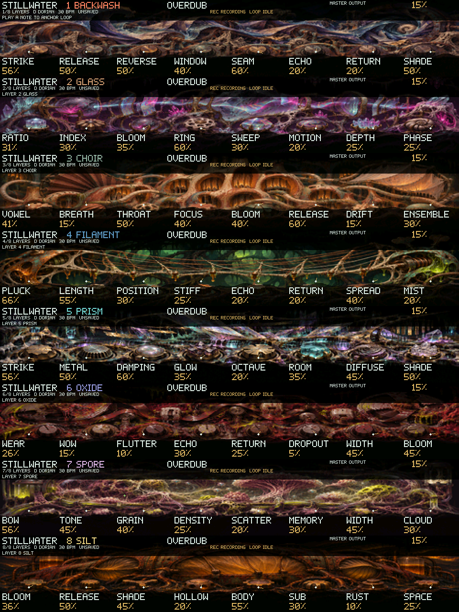

# Stillwater

An independent ambient instrument for **Ableton Push 3 Standalone**. Play the
first note to anchor a four-bar loop, then build up to eight different native
sound layers. The display is an animated, original organic machine; every pad
remains a playable D Dorian note in every view.



Stillwater runs its own C audio engine and Python hardware interface on the
existing AbletonOS. It is not an Ableton product or a plugin. Installation is an
advanced, root-access hardware modification: read the complete
[installation and recovery guide](docs/INSTALL.md) before changing a device.
No Ableton software, firmware, device backup, user song or recording is included.

- Eight distinct sources/effect buses: **Silt, Filament, Glass, Choir, Oxide,
  Backwash, Spore, Prism**; eight live macros per sound, separate mixer and master.
- Blank first layer, performed velocity/duration capture, ongoing overdub,
  epoch-safe undo/redo, asynchronous autosave and no-overwrite song library.
- Actual screen+stereo performance film, exact next-loop WAV export and a
  retrospective 30-second Bottle capture.
- Local Unix-socket control for external tools/agents; no onboard language
  model, voice assistant, cloud requirement or network listener.
- Quiet bounded same-app recovery, with a deliberate return to stock software.

[Controls](docs/CONTROLS.md) · [Install/recover](docs/INSTALL.md) ·
[Develop/test](docs/DEVELOPMENT.md) · [Architecture](docs/ARCHITECTURE.md) ·
[Agent interface](docs/AGENT_API.md) · [Licenses/credits](docs/CREDITS.md)

## Try the engine without hardware

On Linux with Python 3.11+ and a C11 compiler:

```sh
sh scripts/build.sh
python3 -m unittest discover -s tests -v
```

Install FFmpeg/ffprobe and `python3 -m pip install -r requirements-dev.txt` for
media tests, artwork conversion and the full offline workflow:

```sh
python3 scripts/rehearse-v2.py
```

This creates synthetic songs and renders production DSP/graphics to `.build/`;
it opens no ALSA audio output, USB display or physical MIDI port. It does not
play through speakers. [Development](docs/DEVELOPMENT.md) explains dependencies,
outputs, cross-building and a separate full-entry smoke check.

## Compatibility and limits

Verified hardware is Push 3 **Standalone**, with Push 2.3.5b1 / Live 12.3.5b1
beta retained on the tested installation. This does not establish compatibility
with every current or future firmware, Push 2, controller-only Push 3, desktop
Live or other audio devices. No firmware downgrade/update is part of this project.

One shared four-bar loop (16 beats), eight layers, 256 recorded events per layer,
64 global playback voices plus eight manual voices and eight brief steal tails.
Held capture ends after at most one loop. No input recording, arrangement timeline,
plugin host, imported step-song conversion or calibrated full MPE. Library names
are generated rather than typed on-device. Films require working FFmpeg/ffprobe
and storage; limits are 30 minutes and a 512MB free-space reserve.

Automated offline and hardware checks covered controls, ownership, persistence,
codec/sample alignment and timing. They do not claim human listening approval,
universal hardware safety, vendor support or a security audit. The sanitized
snapshot deliberately excludes private deployment history and personal data.

Original code and artwork are provided under [MIT](LICENSE), with retained
[hardware-protocol attribution](NOTICE) and [third-party license](LICENSE.push-hack).
The artwork was generated with an image-generation tool, then prepared and animated
by original renderer code. FFmpeg is obtained separately under its own license.
