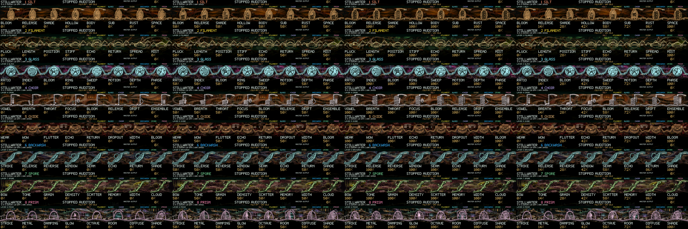

# V5 material worlds

Every control is a physical part of its sound's world. The complete object
remains visible at zero, half and full settings. Increasing a value moves a
contact, changes an opening or rearranges material; it never fills a black
remaining-travel rectangle. All64 macros keep their existing names, order and
sound behavior. Numbers retain the exact stored value.

| Sound | Complete construction | Exact setting contact |
|---|---|---|
| Silt | Amber amphora rooted in sediment pipes | Ceramic float along its curved inner wall |
| Filament | Wire bridge and ceramic anchors | Knotted saddle attached to the main strand |
| Glass | Overlapping cracked lenses and chipped socket | Prismatic tooth on a 270-degree lens rim |
| Choir | Articulated ceramic ribs and woven membrane | Lavender collar on the continuous backbone |
| Oxide | Continuous tape loop, reels and return arch | Worn head straddling the exposed tape |
| Backwash | Forked stone river, water and visible bed | Gate stone touching both channel banks |
| Spore | Living root, seed chambers and dormant husk | Pearl clasped into the main root |
| Prism | Quartz/metal leaves and a grown-in hinge | Terminal facet following a half-ellipse |

Native envelope/effect energy stirs only existing positive material: suspended
grains, return wire, lens interiors, membrane, tape, currents, side chambers and
crystal facets. It never moves the exact contact or permanent range witnesses.
Silent scenes stay stationary. Macro-specific secondary structures vary all eight
columns within each family; Glass Ratio and Prism Octave preserve exact native
branch thresholds rather than relying on coarse image poses.

Original deterministic geometry uses owned V2 grain and palettes. No reference
screenshot, commercial plugin artwork or copied design is bundled. The source
geometry lives in `src/material_controls.py` and `scripts/prepare-v5-art.py`.
[Asset format and provenance](../assets/v5/README.md) describe scene registration,
cache sizes and explicit positive-material support atlases.

*Actual transmitted Push pixels from isolated synthetic/master-zero acceptance;
not camera photographs or a physical performance.*

## Validation and limits

The V5 regression suite checks exact paths at every1% and coarse rounding
boundary, registered borders, fixed contacts/witnesses, startup failure for
missing art, page transitions and native-energy gating. Every one of4,352
geometry/audio combinations changes only supported material, with at least20
changed pixels. The deterministic bake reproduces all26 generated data files.
The36-check rehearsal exercises the production MIDI parser, native engine,
renderer and file workers, including genuine H264/AAC film and sample-exact WAV.

An isolated scripted Push acceptance passed94 checks across384 actual transmitted
frames and256 macro sequences. These frames contain fresh synthetic test state,
master zero, without personal songs or recordings. Measured display rate was
9.99fps with zero xruns. This is display-buffer and scripted-control evidence,
not camera footage, physical encoder feel, listening or glare/color acceptance.
[Selected actual pixels and provenance](MEDIA.md) are included; device logs,
identities, user-state inventories and private reference images are excluded.

V5 changes no synthesis, music control, persistence, native ABI, boot ownership
or recovery behavior. ABI5, schema3 and gentle sound version2 remain paired;
existing music retains its original sound. [Sound compatibility](GENTLE_SOUND.md).
